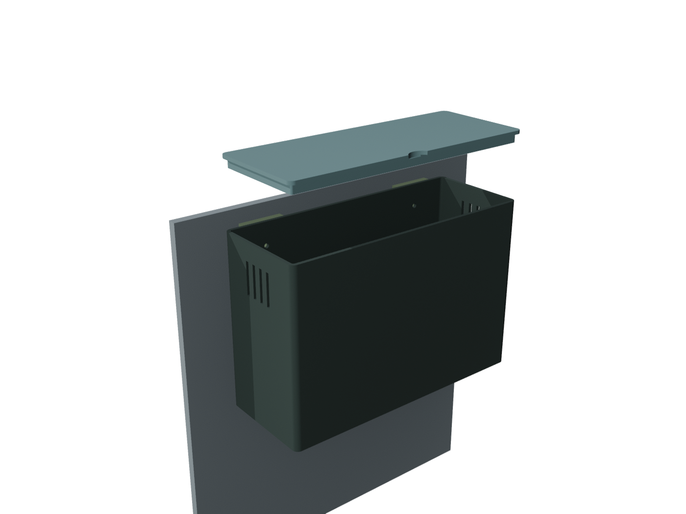
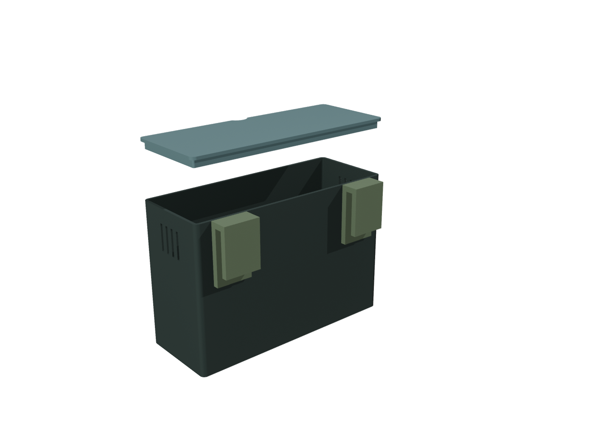

# Component Box

This is a small box for the electronics. It **hangs on the tank's long glass wall** using two glass clips, which work like the hook on the Feeder's main body. The **lid lifts off**. The tank is about 400 × 200 mm and 350–400 mm tall.

 

**Draft:** nothing has been measured yet, and the sizes are guesses based on our modules.

## Parts

`print/parts.txt` is rewritten every time the script runs.

| Print (PLA or PETG, no supports) | Qty | Size | How it sits on the bed |
|---|---|---|---|
| `print/box.stl` | 1 | 180 × 70 × 120 mm | Open side up |
| `print/lid.stl` | 1 | 180 × 70 × 8 mm | Top face down |
| `print/glass_clip.stl` | 2 | 50 × 15 × 30 mm | On its side, with the U shape flat |

Hardware:
- 4 × M3 × 10 mm bolts and 4 × M3 nuts. The bolt head goes inside the box, and the nut drops into a hex pocket on the clip so nothing scratches the glass.
- Optional: 6 × 16 mm rubber grommets.

## How it works

- **Clips.** Each clip is an upside-down U that sits over the top edge of the glass. One plate is bolted to the box's back, and the other reaches 35 mm down inside the tank. The top of the clip is level with the top of the box. The two clips are separate parts, so if the glass is thicker or thinner than expected you only reprint the clips.
- **Cables.** They leave through six 16 mm holes in the **floor**: pH, turbidity, temperature, pump, servo, and USB/power. Water running down a cable drips off underneath instead of getting in. A BNC plug fits through a 16 mm hole.
- **Vents.** There are four slots high on each short side.
- **Lid.** It has a lip that drops inside the walls, and a finger notch on the front edge for lifting it.
- **Space inside.** 175 × 65 × 117 mm. That's room for the ESP32, the relay, and the pH, turbidity and DS18B20 boards. The power bank stays outside.

## Before printing

- **`glass_gap`:** the glass thickness + 0.4 mm. It's 6.4 mm by default, the same as the Feeder. If the glass is thinner, stick foam tape inside the clip.
- **Plastic rim:** check whether the tank has a plastic rim on top. If it does, the clips need a bigger gap or a different shape.

## Changing a size

Edit `PARAMS` at the top of `build_component_box.py`, then run:

```
Y:\Applications\FreeCAD\bin\freecadcmd.exe cad\component-box\build_component_box.py
```

To view the assembled box hanging on a slice of glass, open `component_box.FCStd` in FreeCAD.
